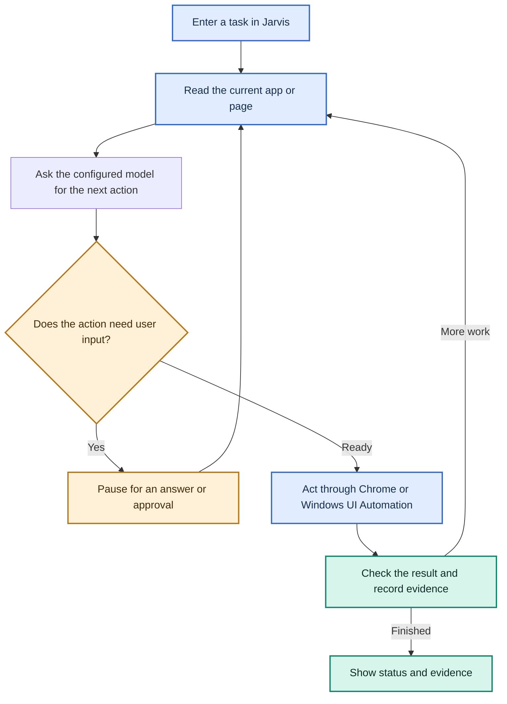

# Jarvis for Windows 11

**A desktop assistant that shows the evidence behind a completed task.**

Give Jarvis an instruction in plain English. Its Python and PySide6 app can work through Chrome or supported Windows UI Automation controls. The result panel reports what it verified, such as a saved file’s contents or a matching message in Sent.

[Windows executable](#windows-executable) · [Source setup](#set-up-and-launch-from-source) · [Model setup](#choose-a-model) · [Chrome and Gmail](#use-chrome-and-gmail)

## Task lifecycle



## Windows executable

After a successful [Windows build and tests](https://github.com/Dhruvkp07/Jarvis/actions/workflows/windows.yml) run, open its **Artifacts** section and download **Jarvis-Windows-x64**. Extract the entire folder and launch `Jarvis.exe`. Google Chrome and your chosen model provider are also required. The workflow runs the test suite and checks the packaged app with an actual Chrome form before uploading the executable.

## Set up and launch from source

Install 64-bit Python 3.12 and Google Chrome. Use the Python installer option that installs the Windows Python Launcher (`py`). Extract the release ZIP, open PowerShell in the extracted folder, and run:

```powershell
powershell -NoProfile -ExecutionPolicy Bypass -File .\setup.ps1
.\launch.cmd
```

The shortcut **Ctrl+Shift+F10** stops the task system-wide. Pause freezes subsequent actions, and Resume refreshes the app and page before planning again. Physical keyboard or mouse input outside Jarvis pauses a running task. An operation already issued to Chrome or Windows may finish after Stop.

## Choose a model

| Provider | Setup |
| --- | --- |
| Ollama | Install and start Ollama for Windows. Pull a local model, for example `ollama pull qwen2.5:7b`. In Jarvis choose **ollama**, enter the installed model name, keep **Local-only model inputs** checked, and click **Test connection**. Keep **Model supports vision** clear for a text-only model. |
| Gemini | Choose **gemini**, enter a model available to your API key, for example `gemini-2.5-flash`, clear **Local-only model inputs**, enter your key, and click **Test connection**. Jarvis stores the key in Windows Credential Manager. |

A model connection test checks structured output. When image input is enabled, the test also uses a synthetic test image. Gemini receives the instruction and applicable text from the task interface. To let Gemini see screen pixels, enable both **Model supports vision** and **Allow Gemini to receive screen images**. Images captured during a task are kept in memory. Ollama is restricted to a numeric loopback address and must report locally installed weights. The local-only setting controls model traffic. Chrome still accesses the websites needed for the task.

## Use Chrome and Gmail

Choose **Open Jarvis Chrome for sign-in**, sign in to your chosen account in that Chrome window, and close the window before pressing **Run**. The profile is under `%LOCALAPPDATA%\Jarvis\ChromeProfile`. Use English for Gmail and Windows file dialog labels in this release. If a sign-in challenge appears during a task, complete it manually and use **Continue** in Jarvis.

Jarvis looks for requested files in Windows Downloads. File and contact ambiguities surface in the task panel. Gmail uses a dedicated workflow that verifies a single To recipient, subject, body, and selected attachments. It asks to review the verified draft before sending by default. To enable hands-off sending, opt in under Provider settings and give an explicit send instruction. Jarvis checks Sent and tracks attempted sends on disk. If verification is uncertain, inspect Sent before sending manually.

Try these instructions:

- “Open Notepad, type ‘Jarvis is ready’, and save the document as Jarvis-sample.txt in Documents.”
- “Open the latest quotation in Downloads, open Gmail in Chrome, attach the quotation, and email it to Priya with a short follow-up.”
- “Open https://example.com in Chrome, read the heading and report what you find.”

Native actions cover Notepad, Calculator, File Explorer, Paint, and the Chrome profile’s Open dialog. Browser controls are taken from the main page. Sites that depend on inaccessible controls, unfamiliar dialogs, embedded frames, or unsupported login flows may need a manual step. If Gmail changes its interface, Jarvis may leave a draft or report an uncertain result.

## Checks and packaging

```powershell
powershell -NoProfile -ExecutionPolicy Bypass -File .\setup.ps1 -Test
powershell -NoProfile -ExecutionPolicy Bypass -File .\setup.ps1 -NativeSmoke
powershell -NoProfile -ExecutionPolicy Bypass -File .\setup.ps1 -Build
```

- **Test** runs the automated suite. Chrome opens local fixtures to test the form, file upload, contact resolution, draft review, Sent verification, and duplicate prevention. Provider HTTP responses are simulated. On Linux, point `JARVIS_TEST_CHROMIUM` to a working Chromium executable.
- **NativeSmoke** requires an unlocked Windows desktop. Close Jarvis first. The script exercises actual Notepad and Chrome’s native Open dialog with a temporary file. When prompted, move the mouse and press **Ctrl+Shift+F10** while Chrome has focus.
- **Build** runs PyInstaller on Windows and produces `dist\Jarvis\Jarvis.exe`. Keep the entire `dist\Jarvis` folder together when moving the executable.
- For a signed-in Gmail acceptance check, start with a controlled test inbox and attach a sample file. Verify the draft in review mode, approve delivery to the test address, and check the message in Sent. Use a real model through **Test connection** before the live workflow.

References for setup and compatibility: [Playwright persistent profiles](https://playwright.dev/python/docs/api/class-browsertype#browser-type-launch-persistent-context), [Gemini structured output](https://ai.google.dev/gemini-api/docs/structured-output), [Ollama chat API](https://docs.ollama.com/api/chat), [Windows global hotkeys](https://learn.microsoft.com/en-us/windows/win32/api/winuser/nf-winuser-registerhotkey).
